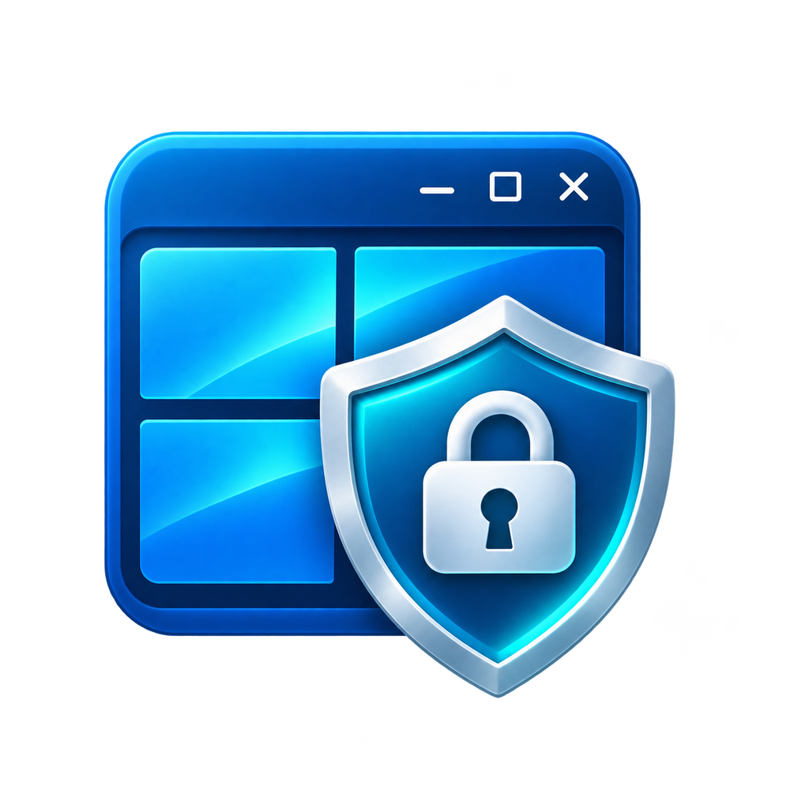

<p align="center"></p>

# Window Guard

Window Guard is a small Windows tool for locking selected applications with a PIN. It hides the application's windows while they're locked, then shows them again when you enter the right PIN.

I originally wanted a simple way to lock programs such as Firefox. The project has grown a little since then, but the idea is still the same: pick the programs you want to protect and leave Window Guard running in the tray.

**Latest release:** [v0.6.0](https://github.com/Gexos/window-guard/releases/tag/v0.6.0)

Download the latest published build from [GitHub Releases](https://github.com/Gexos/window-guard/releases).

## What it does

- Keeps a list of the applications you want to protect.
- Locks each application separately. Unlocking one doesn't unlock the others.
- Relocks an application after its processes have fully closed, so opening it again requires the PIN.
- Lets you pick an application from its running windows. This is useful for portable apps with separate launchers.
- Runs in the system tray and can start with Windows.
- Has a Settings window and an optional **Ctrl+Shift+L** shortcut to lock everything.
- Can export a diagnostics report when something isn't detected properly.

**Please read this before using it:** Window Guard is a privacy tool, not a replacement for your Windows login. Someone who can stop the program or change its configuration can bypass it. A protected window may also show briefly before Window Guard hides it.

## Getting started

1. Start Window Guard.
2. Open the program you want to protect.
3. Click **Add Running App** and select the program's actual executable.
4. Open **Tools → Set / Change PIN** and set a PIN (4–12 digits).
5. Enter the PIN when prompted to use the protected program.
6. Close that program completely. Window Guard will lock it again for the next launch.

For **Firefox Portable**, select `firefox.exe`, **not** the `FirefoxPortable.exe` launcher. The launcher usually doesn't own the browser window.

## Download and requirements

The project is for Windows 10 and 11.

- **EXE:** Download a tested build from [GitHub Releases](https://github.com/Gexos/window-guard/releases). Python isn't needed to run the EXE.
- **Source:** Python 3.10 or later, plus `pystray` and `Pillow`.

To run from source:

```bat
python -m pip install -r requirements.txt
python window_guard.py
```

Or run `run_window_guard.bat`.

## Build the EXE

On Windows, double-click `build_window_guard.bat`. It installs the build requirements and runs PyInstaller with the Windows icon and bundled image assets.

You should find these files in `dist`:

```text
dist/
  WindowGuard.exe
  WindowGuard_Help.html
  WindowGuard_Help.pdf
  README.md
  LICENSE
```

Keep the two Help files next to `WindowGuard.exe`; the **Help** menu opens them from that folder. The icon files are bundled inside the EXE.

To generate a SHA-256 checksum for your build, run `hash_release.bat`. It creates `SHA256SUMS.txt`.

## Settings and updates

Open **Tools → Settings** for startup, tray, removal confirmation, shortcut and monitoring options.

The optional **Ctrl+Shift+L** shortcut may conflict with another program's shortcut. It's off by default. You can always use **Lock All Now** in the menu or system tray.

**GitHub → Check for Updates** opens the [Releases page](https://github.com/Gexos/window-guard/releases). Window Guard does not download or install updates automatically.

## Where settings are stored

```text
%APPDATA%\WindowGuard\config.json
```

The file holds your protected-app list and PIN verification data. The PIN itself isn't saved as plain text. Configuration files and diagnostics reports can contain personal information, so keep them private.

## Development

The repo includes Windows GitHub Actions checks and a build workflow. The build workflow produces an artifact under the Actions run; **it does not automatically publish a release**.

See the [roadmap](ROADMAP.md), [changelog](CHANGELOG.md) and [contributing notes](CONTRIBUTING.md). Bugs and suggestions are welcome through [GitHub Issues](https://github.com/Gexos/window-guard/issues).

## Documentation

- [HTML Help](WindowGuard_Help.html)
- [PDF Help](WindowGuard_Help.pdf)
- [Security notes](SECURITY.md)

## Author and license

**Giorgos Xanthopoulos aka gexos**

MIT License. See [LICENSE](LICENSE).
